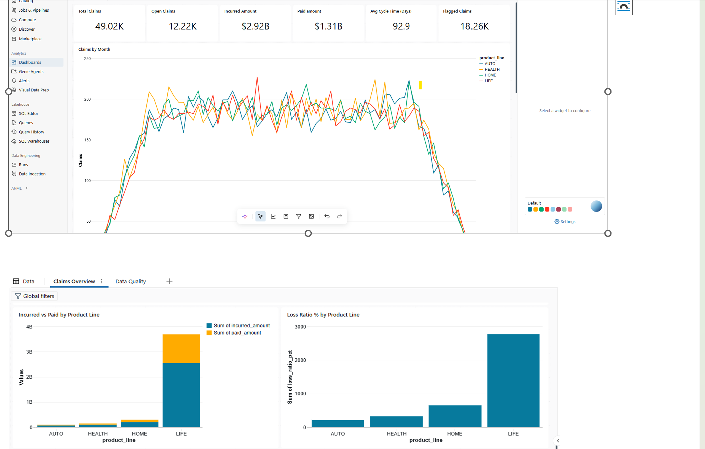
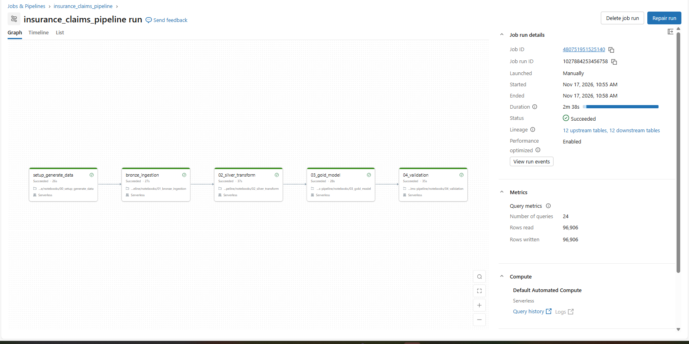

# Insurance Claims Data Pipeline — End-to-End on Databricks

An end-to-end data engineering project that ingests insurance claims data from a simulated legacy system into a **Databricks Lakehouse** (Medallion architecture), validates every load automatically, and serves claims KPIs in a **Databricks AI/BI Dashboard**.

> All data is **synthetic**, generated by `data_generator/generate_claims.py`. No real policyholder or client data is used.



---

## 📌 Business Problem

Claims data in the legacy system had:
- Duplicate claim records from repeated extracts
- Inconsistent status codes (`OPN`, `Open`, `O` all meaning *open*)
- Missing mandatory fields and claims linked to policies that don't exist
- Manual, spreadsheet-based reconciliation after every load

**Goal:** an automated pipeline that delivers trusted, reconciled claims data to analysts and business users.

---

## 🏗️ Architecture

```
Legacy claims extract (CSV: customers, policies, claims, payments)
        │  lands in a Unity Catalog Volume
        ▼
Auto Loader (Lakeflow Connect) ── incremental ingestion
        ▼
BRONZE   raw Delta tables + audit columns (_ingest_ts, _source_file)
        ▼  PySpark: type casting, status standardization, dedup, DQ rules
SILVER   clean tables (MERGE upsert)  ──►  silver_claims_quarantine (with reason)
        ▼  star schema + business logic
GOLD     fact_claims, dim_customer, dim_policy, dim_date, KPI tables
        │
        ├──► 04_validation → validation_log (fails the job on bad loads)
        └──► Databricks AI/BI Dashboard
```

All steps run as one **Databricks Job** (Lakeflow Jobs): `setup → bronze → silver → gold → validation`.



---

## 🛠️ Tech Stack

| Layer | Tools |
|---|---|
| Platform | Databricks (serverless, Unity Catalog) |
| Ingestion | Auto Loader (`cloudFiles`) from a UC Volume |
| Storage | Delta Lake, Medallion architecture |
| Transformation | PySpark, Spark SQL, `MERGE` |
| Validation | PySpark reconciliation framework |
| Orchestration | Databricks Jobs |
| Reporting | Databricks AI/BI Dashboard (SQL) |
| Version control | GitHub + Databricks Git folders |

---

## 📂 Repository Structure

```
insurance-claims-pipeline/
├── data_generator/
│   └── generate_claims.py        # synthetic source data with planted DQ issues
├── notebooks/
│   ├── _config.py                # catalog/schema/paths (shared)
│   ├── 00_setup_generate_data.py # creates schema + volume, lands source CSVs
│   ├── 01_bronze_ingestion.py    # Auto Loader → bronze Delta tables
│   ├── 02_silver_transform.py    # clean, standardize, dedup, quarantine, MERGE
│   ├── 03_gold_model.py          # star schema, risk flags, KPI tables
│   └── 04_validation.py          # reconciliation checks → validation_log
├── dashboard/
│   ├── screenshots/              # dashboard images
│   └── power_bi_guide.md         # optional: connecting Power BI instead
├── docs/
│   ├── data_dictionary.md
│   ├── job_run.png
│   └── validation_results.png
└── README.md
```

---

## 🔄 Key Transformations (Silver)

- **Deduplication:** keep the latest version of each claim by `last_updated` (window + `row_number`)
- **Standardization:** 12 raw status variants → 4 standard codes
- **Data-quality rules → quarantine** (not silently dropped): missing `policy_id` / `claim_date`, orphan policy, `paid_amount > claim_amount`, close date before report date
- **Incremental load:** `MERGE` into `silver_claims` so re-runs and late updates don't create duplicates

## ⭐ Gold Layer

- `fact_claims` — claim grain with `cycle_time_days`, `report_lag_days`, total payments
- Risk flags: claim within 30 days of policy start, amount > 3× product-line average, late reporting
- `kpi_claims_monthly`, `kpi_loss_ratio` (paid losses ÷ premium by product line)

---

## ✅ Data Validation Framework

`04_validation.py` runs after every load, appends to `validation_log`, and **fails the job** if any check fails.

| Check | Layers |
|---|---|
| Row counts | source files → bronze (all 4 tables) |
| Checksums (SUM of amounts) | source → bronze, silver → gold |
| Dedup reconciliation | distinct bronze claims = silver + quarantine |
| Mandatory-field nulls | silver |
| Business rules | silver |
| Referential integrity | gold (claim → policy, claim → customer) |
| Payments reconcile to paid amount | closed claims |


**Real catch:** when the source extract was re-generated, the framework detected a source-to-bronze row-count and checksum mismatch and failed the job before bad data reached reporting. The setup step was then made idempotent.

---

## 📈 Results (50,000-claim run)

| Metric | Value |
|---|---|
| Source claim records | 51,000 |
| Duplicates removed | 1,000 |
| Records quarantined with reason | 977 |
| Clean claims loaded to silver/gold | 49,023 |
| Validation checks passed | all |
| Manual reconciliation | replaced by automated checks on every run |

---

## 📊 Dashboard (Databricks AI/BI)

**Claims Overview:** KPI cards (total, open, incurred, paid, avg cycle time, flagged), claims by month, incurred vs paid and loss ratio by product line, claims by state.

**Data Quality:** latest validation results and quarantined records by reason.


---

## ▶️ How to Run (Databricks Free Edition works)

1. **Clone into Databricks:** Workspace → **Create → Git folder** → paste this repo's URL.
2. In `notebooks/_config.py`, set the `catalog` default to a catalog in your workspace (run `SHOW CATALOGS` to see yours).
3. Run `notebooks/00_setup_generate_data` (serverless). It creates the `insurance_claims` schema and lands the source CSVs.
4. Run `01` → `02` → `03` → `04` in order, or create a **Job** with one notebook task per step.
5. Build the dashboard from the gold tables (or connect Power BI using `dashboard/power_bi_guide.md`).

---

## 💡 Lessons Learned

- Build validation **with** the pipeline, not after it. Reconciliation is what makes data trusted.
- Quarantine bad records with a reason instead of dropping them, so the business can fix the source.
- Make every step idempotent; re-running a job should never silently change results.
- Standardize codes early (silver) to avoid rework in every report downstream.

---

## 👤 Author

**Nikitha Aynampudi** — Data Engineer
[LinkedIn](www.linkedin.com/in/nikitha-aynampudi-87778626b) · [GitHub](https://github.com/NikithaData)
